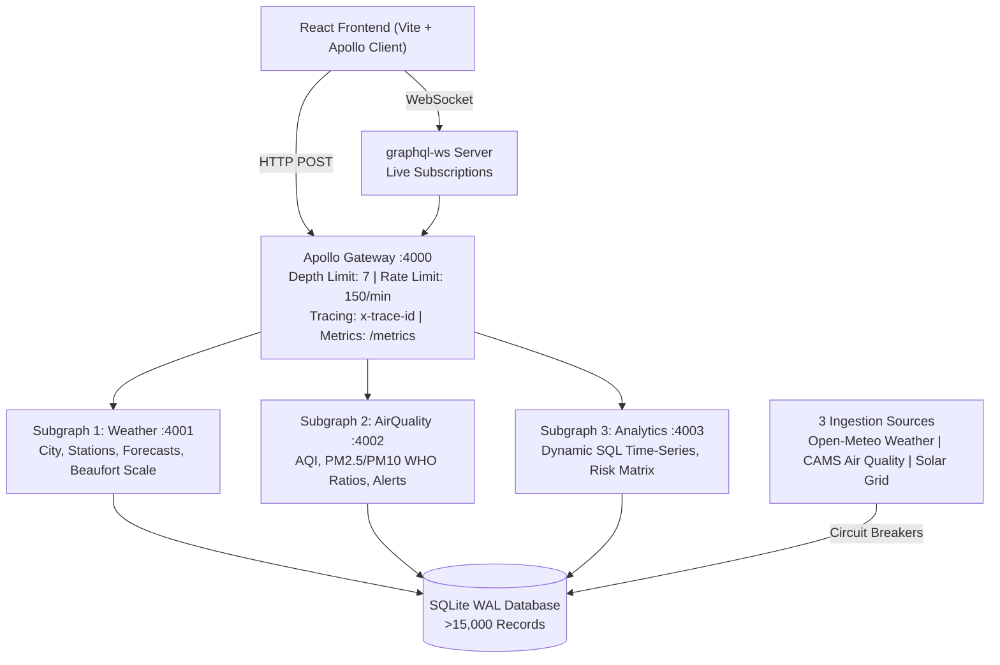

# MeteoGraph

Distributed climate and meteorological intelligence platform built with **Apollo Federation v2**, **Node.js (ES Modules)**, and **React (Vite)**.

MeteoGraph implements a federated microservices architecture under a unified GraphQL supergraph, delivering real-time weather observation, air quality metrics, dynamic time-series aggregations, and automated multi-source ingestion.

---

## Architecture



---

## Features & Specifications

| Requirement | Implementation |
|---|---|
| **1. Exclusive GraphQL API** | All client-server communication runs over GraphQL (Apollo Client HTTP + WebSocket links). No REST endpoints for application logic. |
| **2. Multi-Source Ingestion** | Background scheduler automatically polls 3 independent sources: Open-Meteo Weather, CAMS Air Quality, and Solar/Climate Grid. Maintained at **>15,000 records** in SQLite. |
| **3. Operations & Nesting** | Supports Queries, Mutations, and Subscriptions. Deep nesting (up to 5-7 levels) with dynamic computed fields (Beaufort scale, WHO air guideline ratios, resilience score). |
| **4. Search, Filter, Pagination** | Prefix search by city/country, filtering by climate zone, directional sorting (`ASC`/`DESC`), and cursor-based pagination with `totalCount`. |
| **5. Resilience & Performance** | SQLite WAL mode with indexed queries. Automated **Circuit Breaker** pattern protects against third-party API downtime with fallback data generation. |
| **6. Load Control & Monitoring** | Query depth limiter (max depth 7), rate limiter (150 req/min), Prometheus metrics (`/metrics`), and distributed tracing header (`x-trace-id`). |
| **7. GraphQL Federation v2** | Supergraph architecture composed of an Apollo Gateway (:4000) and 3 independent subgraphs (:4001, :4002, :4003). |

---

## Quick Start

### 1. Installation
```bash
npm install
npm --prefix client install
```

### 2. Run End-to-End Test Suite
```bash
npm run test:e2e
```

### 3. Launch Backend Services
```bash
npm start
```
* **GraphQL Gateway:** `http://localhost:4000/graphql`
* **WebSocket Endpoint:** `ws://localhost:4000/graphql`
* **Prometheus Metrics:** `http://localhost:4000/metrics`
* **Healthcheck:** `http://localhost:4000/health`

### 4. Launch Frontend
```bash
npm run client
```
Open your browser at **`http://localhost:3000`**.

---

## Example GraphQL Operations

### Federated Cross-Subgraph Query
```graphql
query FederatedWeatherAudit {
  cities(limit: 2) {
    edges {
      node {
        name
        country
        climateZone
        resilienceScore
        currentWeather {
          temperature
          weatherCondition
          windDetails {
            beaufortDescription
          }
        }
        airQuality {
          aqiUs
          category
          pollutantBreakdown {
            pm25WhoRatio
          }
        }
      }
    }
  }
}
```

### Dynamic SQL Aggregations
```graphql
query MonthlyAnalytics {
  aggregateMetrics(metric: "temperature", groupBy: "MONTH") {
    timeBucket
    average
    min
    max
    count
  }
}
```

### Broadcast Severe Weather Alert (Mutation)
```graphql
mutation CreateAlert {
  createWeatherAlert(
    cityId: "city-tokyo"
    eventType: "TYPHOON_WARNING"
    severity: "SEVERE"
    headline: "Typhoon Approaching"
    description: "Wind gusts up to 120 km/h recorded"
  ) {
    id
    headline
    severity
  }
}
```
